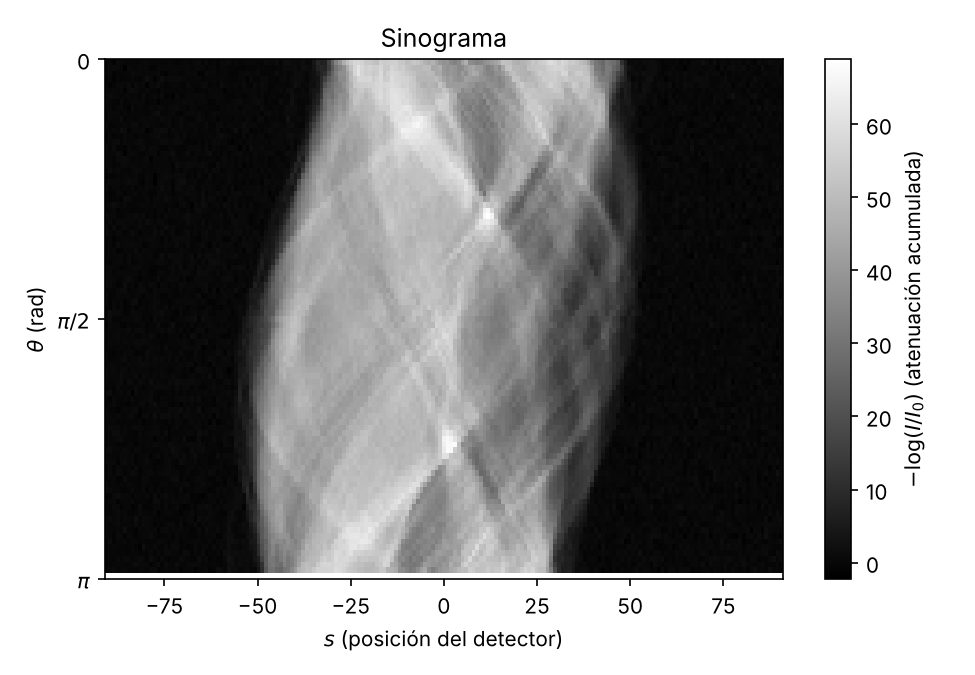
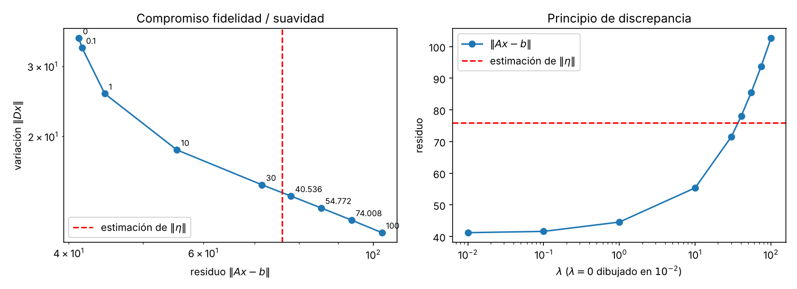
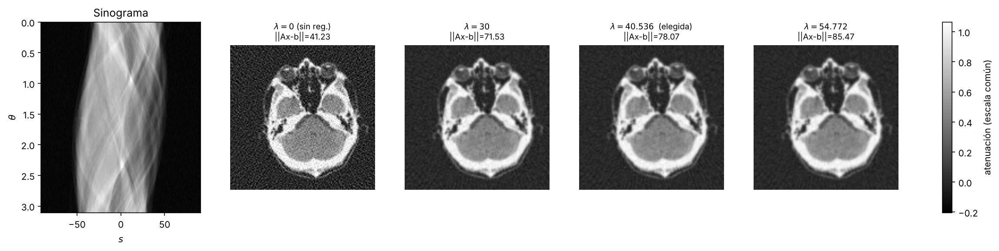

# Reconstrucción y regularización en imágenes tomográficas

Métodos Computacionales: TP

<!-- Presentamos cómo se reconstruye una imagen a partir de proyecciones, qué falla con ruido y cómo se arregla con regularización. Vamos de un fantoma 8x8 a una tomografía real de 128x128. -->

---

# ¿Cómo se recupera una imagen a partir de sus proyecciones?

- Modelo directo: $b = A x$
- $x$: imagen vectorizada. $b$: mediciones de los rayos.
- Con ruido: $b_\sigma = b + \eta$. Se regulariza.

<!-- A es una matriz binaria: una fila por rayo, una columna por píxel. El problema inverso es hallar x conociendo b y la geometría. Todo el TP gira alrededor de qué tan bien se puede invertir A. -->

---

# Ej. 1: ¿Una imagen es un vector?

- Fantoma 8x8 → vector de **64** componentes
- Pixel $(i,j)$ ↔ componente $k = i\,n + j$
- $x_k$ = atenuación del píxel

Mirar: valores por píxel; el negro es cero atenuación.

<!-- Verificamos que el reshape es reversible y que cambiar el píxel (3,5) toca solo la componente 29. Cada medición será una suma de atenuaciones. -->

---

# Ej. 2: ¿Qué es un rayo?

- Rayo $(\alpha,\beta,s)$: píxeles con $\alpha i+\beta j=s$
- Una medición es la **suma** bajo el rayo
- $(2,1)$ toca solo 4 píxeles

Mirar: fila, columna, diagonales y una recta inclinada.

<!-- Dos rayos distintos pueden dar el mismo valor porque la medición es un solo número. Las direcciones inclinadas aportan ecuaciones, pero con poca información cada una. -->

---

# Ej. 3: ¿Cómo es la matriz A?

- Fila = rayo; columna = píxel
- Con 2 direcciones: $A\in\mathbb{R}^{16\times 64}$
- Dispersa: **8** de 64 píxeles por rayo

Mirar: pocos unos sobre muchos ceros.

<!-- Una fila tiene unos en los píxeles que atraviesa el rayo. Una columna tiene unos en los rayos que pasan por un píxel. -->

---

# Ej. 3: ¿Qué da $b = A x$?

- $b[:8]$ = sumas por fila
- $b[8:]$ = sumas por columna
- $\sum b = 26{,}2 = 2\cdot\sum x$

Mirar: las barras copian el perfil del fantoma.

<!-- Chequeamos que b coincide con las sumas por fila y por columna del fantoma. Es la prueba de que A está bien armada. -->

---

# Ej. 4: ¿Alcanzan las mediciones?

| Direcciones | Rango | dim Nul |
|---|---|---|
| 2 (16x64) | 15 | 49 |
| 4 (46x64) | 39 | 25 |
| 7 (119x64) | **64** | 0 |

<!-- Solo con 7 direcciones el rango es 64 y la solución es única. Con menos, el espacio nulo no es trivial y hay infinitas imágenes compatibles con las mediciones. -->

---

# Ej. 4: ¿Dos imágenes con las mismas mediciones?

- $v\in\mathrm{Nul}(A_4)$: suma 0 en toda recta
- $x_{alt}=x+\alpha v$ cambia la imagen
- Pero $A_4 x_{alt}=A_4 x$

Mirar: fantoma, $\alpha v$ y la imagen alternativa.

<!-- Como rango(A4)=39 < 64 hay patrones invisibles. A4 solo suma por filas, columnas y diagonales; un patrón que suma cero en todas esas rectas no se ve. Acá ||x_alt - x_fantoma|| = 1,0 pero ||A4 x_alt - b4|| = 1,9e-15. -->

---

# Ej. 4: ¿Se distinguen las mediciones?

- $A_4 x_{fantoma}$ y $A_4 x_{alt}$ se superponen
- Diferencia: **1,9e-15**
- Con $A_4$ no hay unicidad

Mirar: las dos curvas son indistinguibles.

<!-- Las 46 mediciones son idénticas para dos imágenes bien distintas. Esa es la no unicidad: ningún algoritmo puede decidir entre ambas. -->

---

# Ej. 5: ¿Se recupera la imagen sin ruido?

- Residuo ≈ 1e-14 en los tres casos
- Error: 0,469 (A2), 0,137 (A4)
- **2,1e-15** con A7

Mirar: filas original, reconstrucción y diferencia.

<!-- lstsq devuelve la solución de norma mínima. Con A2 y A4 reproduce las mediciones pero la imagen sale distinta. Con A7 se recupera exacta. -->

---

# Ej. 5: ¿Basta un residuo chico?

- Residuo mide coherencia, no parecido
- El error vive en $\mathrm{Nul}(A)$
- Solo vale con rango completo

Mirar: la diferencia en A7 es ruido numérico.

<!-- Un residuo casi cero solo asegura buena reconstrucción si A tiene rango completo. Si no, se puede sumar cualquier elemento del espacio nulo sin cambiar las mediciones. -->

---

# Ej. 6: ¿Qué hace el ruido?

- $b_\sigma=b_7+\sigma\,\text{escala}\,z$, semilla 912
- Error 0,021 → 0,210 para $\sigma$ de 0,01 a 0,10
- Crece proporcional a $\sigma$

Mirar: más $\sigma$, más grano.

<!-- Usamos siempre el mismo z, por eso el ruido tiene la misma forma y solo cambia su tamaño. Escala = 1,0963. -->

---

# Ej. 6: ¿Por qué residuo no nulo y negativos?

| $\sigma$ | $\lVert\eta\rVert$ | residuo | error |
|---|---|---|---|
| 0,03 | 0,3977 | 0,2668 | 0,0630 |
| 0,06 | 0,7953 | 0,5336 | 0,1261 |
| 0,10 | 1,3256 | 0,8893 | 0,2102 |

- $b_\sigma\notin\mathrm{Col}(A_7)$; lstsq sin positividad

<!-- Con ruido no existe imagen que reproduzca exacto b. Mínimos cuadrados no impone positividad, así que en los píxeles de valor 0 el ruido puede dar negativos (mínimo -0,085 con sigma 0,06). -->

---

# Ej. 7: ¿Qué propiedad tiene el residuo?

- $A_7^T r\approx 0$: $r\perp\mathrm{Col}(A_7)$
- $A_7\hat{x}$ = proyección ortogonal de $b_\sigma$
- $\|A_7^T r\|=$ **4,1e-14**

<!-- Hay dos proyecciones distintas: la tomográfica, que es la matriz A, y la ortogonal P = A(A^T A)^{-1}A^T. P cumple P² = P y P^T = P. Verificamos ||P b - A x_hat|| = 1,3e-14. -->

---

# Ej. 8: ¿Cómo es el Hessiano?

- $E(x)=\tfrac12\|Ax-b\|^2$, $H=A^TA$ definido positivo
- $\mu_{max}=36{,}46$; $\mu_{min}=0{,}51$
- $\mathrm{cond}(H)\approx$ **71**

<!-- En x_ls el gradiente vale 4,1e-14. El número de condición mide qué tan estirada está la función y determina qué tan lento converge GD. -->

---

# Ej. 8: ¿Qué tasa de aprendizaje sirve?

- Converge si $0<\alpha<2/\mu_{max}$
- $\alpha=1/\mu_{max}$: **1169** iteraciones
- $2{,}05/\mu_{max}$ o más: diverge

Mirar: azul lenta, verde rápida, derecha diverge.

<!-- Con kappa 1,9 son 611 iteraciones; pero kappa 1,99 tarda 2288, porque queda cerca del borde y oscila. Con kappa 0,1 no llega a converger en 3000. -->

---

# Ej. 8: ¿Y Newton?

- $E$ cuadrática → Newton en **1** paso
- Los tres métodos: mismo costo 0,142363
- Con 128x128, $H$ sería 16384x16384

Mirar: lstsq, GD y Newton son iguales.

<!-- ||grad|| baja de 66,7 a 1,67e-14. El error contra el fantoma es 0,1261 en los tres, igual al ej. 6 con sigma 0,06. Newton no escala a imágenes grandes. -->

---

# Ej. 9: ¿Qué es regularizar?

- $J=\tfrac12(\|A_7x-b\|^2+\lambda\|Dx\|^2)$
- $D$ resta píxeles vecinos (112x64)
- $\|Dx_{cte}\|=0$; $\|Dx_{fantoma}\|=$ **2,71**

<!-- D penaliza que píxeles vecinos sean distintos. Una imagen constante no se penaliza. Usamos alpha = 1/L, con L(lambda=1) = 36,477. -->

---

# Ej. 9: ¿Qué lambda conviene?

| $\sigma$ | $\lambda=0$ | $\lambda=0{,}3$ | $\lambda=1$ |
|---|---|---|---|
| 0,00 | **0,0000** | 0,0972 | 0,2000 |
| 0,10 | 0,2101 | **0,1629** | 0,2243 |
| 0,20 | 0,4203 | 0,2814 | **0,2775** |

<!-- Más ruido pide más lambda: compromiso entre sesgo y varianza. Sin ruido, regularizar solo agrega sesgo. -->

---

# Ej. 9: ¿Parar antes también regulariza?

- Con ruido, el error baja y luego sube
- Mínimo: iteración **18** ($\sigma$ 0,10), **9** ($\sigma$ 0,20)
- Sin ruido: baja hasta 0

Mirar: azul ($\lambda=0$) sube al final con ruido.

<!-- Early stopping como regularización implícita: error 0,1618 en la iteración 18 contra 0,2101 al converger. Con sigma 0,20: 0,2720 contra 0,4203. -->

---

# Ej. 9: ¿Cómo se ven las reconstrucciones?

- $\lambda$ adecuado limpia el ruido
- $\lambda$ grande aplana los picos
- Mejor $\lambda$ sube con $\sigma$

Mirar: nitidez contra grano según $\lambda$.

<!-- Sobre-regularizar borra detalle y achata los valores altos. El óptimo depende del nivel de ruido. -->

---

# Ej. 10: ¿Datos reales?

- $n=128$, 90 ángulos, 183 detectores
- $A$: 16470x16384, **0,70%** no nulos
- Se usa GD con $\alpha=1/L$

Mirar: eje $s$ (detector) contra ángulo $\theta$.

<!-- Cada columna del sinograma es una proyección. A es dispersa: 1.876.712 elementos no nulos. ||b|| = 3798,5. La matriz de 128x128 hace inviable Newton. -->

---

# Ej. 10: ¿Qué pasa sin regularizar?

- $\lambda=0$: residuo **41,23**
- $\|\eta\|\approx 75{,}97$: se ajusta el ruido
- Mínimo de la imagen: −0,448

Mirar: grano en el fondo y bordes.

<!-- El residuo queda en 0,54 veces ||eta||: la reconstrucción ajusta el ruido, no solo la señal. Llegó al máximo de 5000 iteraciones. -->

---

# Ej. 10: ¿Cómo se elige $\lambda$?

- Principio de discrepancia: residuo ≈ $\|\eta\|$
- $\lambda=$ **40,536**: residuo 78,07
- Razón con $\|\eta\|$: 1,03

Mirar: la curva cruza la línea roja entre 30 y 100.

<!-- A izquierda la curva L: fidelidad contra suavidad. A derecha el residuo contra lambda; la línea roja es la estimación de ||eta||. Es una heurística: depende de que la estimación del ruido sea buena. -->

---

# Ej. 10: ¿Cómo queda la reconstrucción?

- $\|Dx\|$: 35,27 → **14,17**
- Mínimo: −0,448 → −0,094
- Se conserva la anatomía

Mirar: sinograma, $\lambda=0$ y vecinos de la elegida.

<!-- Con lambda 40,536 desaparece el grano sin borrar las estructuras principales. Con 30 queda algo de grano; con 54,772 empieza a suavizar de más. -->

---

# Ej. 11: ¿Qué aprendimos?

- Rango 15 / 39 / 64 → Nul 49 / 25 / 0
- Con ruido: $\|\eta\|=0{,}795$ vs $\|r\|=0{,}534$

<!-- Fallan existencia, unicidad y estabilidad. lstsq con A2 y A4 reproduce las mediciones pero da errores 0,469 y 0,136. GD tarda 1169 iteraciones, Newton una; cond(H) ≈ 71. -->

---

# Conclusión: un solo hilo

**Modelo directo → unicidad → ruido y mínimos cuadrados → métodos iterativos → regularización → datos reales**

- $b=Ax$ solo se invierte si rango$(A)=64$
- Con ruido, regularizar y elegir $\lambda$ con la discrepancia

<!-- Cerramos el hilo: partimos de un modelo lineal simple, vimos cuándo es invertible, qué pasa con ruido, cómo resolverlo de forma iterativa y cómo la regularización lo hace estable en una tomografía real. -->
